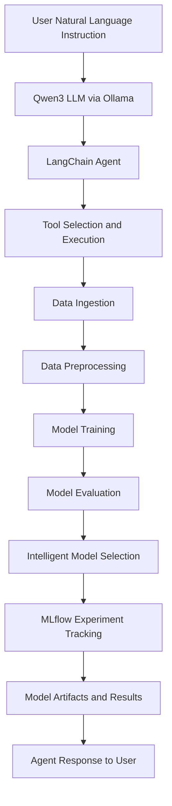

# Autonomous MLOps Agent

\<p align="center">
&#x20; \
&#x20; \
&#x20; \
&#x20; \
&#x20; \
&#x20; \
&#x20; \
&#x20; \
\</p>

\<p align="center">
&#x20; \<strong>AI-Powered Automation for End-to-End Machine Learning and MLOps Workflows\</strong>
\</p>

\<p align="center">
&#x20; \<em>From Traditional Machine Learning to Autonomous MLOps Engineering.\</em>
\</p>

---

## 1. Project Overview

The **Autonomous MLOps Agent** is an AI-powered application designed to automate key stages of the Machine Learning lifecycle using **Qwen3, LangChain, Ollama, and Python**.

The primary objective is to develop an intelligent agent capable of executing end-to-end MLOps workflows through natural-language instructions, reducing the need for manual execution of individual machine learning scripts.

By integrating Large Language Models (LLMs) with LangChain tool calling, the agent interprets user instructions, identifies the required operations, and executes corresponding machine learning tasks through predefined and reusable Python tools.

Users can interact with the agent to perform data inspection, preprocessing, model training, evaluation, model selection, and experiment tracking through a conversational interface.

## 2. Project Objectives

The project focuses on the following objectives:

1. **Automated Data Ingestion:** Load datasets from predefined sources, validate data availability, and perform initial data inspection.

2. **Automated Data Preprocessing:** Identify and handle missing values, process categorical variables, detect data inconsistencies, and prepare datasets for model training.

3. **Automated Model Training:** Execute multiple machine learning algorithms based on user instructions and configured training workflows.

4. **Automated Model Evaluation:** Evaluate trained models using standard regression performance metrics, including Mean Absolute Error (MAE), Root Mean Squared Error (RMSE), and R² Score.

5. **Intelligent Model Selection:** Compare model performance and identify the best-performing model based on selected evaluation criteria.

6. **Experiment Tracking:** Integrate MLflow to track model parameters, evaluation metrics, experiment runs, and model artifacts.

7. **AI-Driven Workflow Execution:** Leverage Qwen3 and LangChain tool calling to interpret natural-language commands and execute the appropriate MLOps operations.

## 3. Technology Stack

\<p align="center">
&#x20; \
\</p>

| Technology   | Purpose                                  |
| ------------ | ---------------------------------------- |
| Python       | Core programming language                |
| Qwen3 1.7B   | Local Large Language Model               |
| Ollama       | Local LLM inference and model serving    |
| LangChain    | Agent orchestration and tool calling     |
| Scikit-learn | Machine Learning algorithms              |
| Pandas       | Data manipulation and preprocessing      |
| NumPy        | Numerical computing                      |
| MLflow       | Experiment tracking and model management |

## 4. System Architecture

The Autonomous MLOps Agent is designed around an AI-driven orchestration architecture.

The Qwen3 language model interprets user instructions, while the LangChain agent selects and executes the appropriate Python tools to perform individual MLOps operations.

### Workflow Diagram



### Core Workflow Components

- **LLM Layer:** Qwen3 interprets natural-language instructions.
- **Agent Layer:** LangChain manages reasoning, tool selection, and execution.
- **Execution Layer:** Python modules perform machine learning operations.
- **Tracking Layer:** MLflow records experiments, parameters, metrics, and artifacts.
- **Output Layer:** The agent communicates execution results to the user.

## 5. Environment Configuration

The project uses **Ollama** to run Qwen3 locally and connect the language model with LangChain through an OpenAI-compatible API endpoint.

### Step 1: Install Ollama

Download and install Ollama:

[https://ollama.com/download](https://ollama.com/download)

### Step 2: Download the Qwen3 Model

Execute the following command:

```bash
ollama pull qwen3:1.7b
```

Verify the installed model:

```bash
ollama list
```

### Step 3: Configure Environment Variables

Create a `.env` file in the root directory of the project.

```env
BASE_URL=http://localhost:11434/v1
API_KEY=ollama
MODEL=qwen3:1.7b
```

### Environment Variable Details

| Variable   | Description                                             |
| ---------- | ------------------------------------------------------- |
| `BASE_URL` | Local Ollama OpenAI-compatible API endpoint             |
| `API_KEY`  | Local API authentication placeholder used by the client |
| `MODEL`    | Qwen3 1.7B model identifier                             |

**Important:** The API key value `ollama` is a local client placeholder, not a cloud API secret. Ensure Ollama is running before executing the agent.

To start the Ollama server:

```bash
ollama serve
```

## 6. Installation and Setup

### Step 1: Clone the Repository

```bash
git clone https://github.com/chandanc5525/Autonomous-MLOps-Agent.git

cd Autonomous-MLOps-Agent
```

### Step 2: Create a Virtual Environment

This project uses `uv` for Python environment and dependency management.

```bash
uv venv
```

Activate the virtual environment on Windows:

```bash
.venv\Scripts\activate
```

### Step 3: Install Dependencies

```bash
uv add langchain langchain-openai langchain-core python-dotenv pandas numpy scikit-learn mlflow
```

### Step 4: Configure Environment Variables

Create the `.env` file in the project root and add the Ollama configuration.

### Step 5: Run the Application

Execute the application using its configured Python entry point once the agent implementation is complete.

## 7. Expected Outcome

The expected outcome is a lightweight, AI-driven MLOps system that demonstrates how Large Language Models and intelligent agents can simplify and automate traditional machine learning workflows.

The project aims to bridge the gap between conventional Machine Learning development and modern AI Engineering by introducing natural-language-driven workflow orchestration.

Key expected capabilities include:

- Natural-language interaction with Machine Learning workflows.
- Automated execution of predefined ML operations.
- Modular and reusable Python components.
- Automated model training and performance evaluation.
- MLflow-based experiment tracking.
- Local LLM integration without requiring paid cloud LLM APIs.

## 8. Chandan-AIOps: Modular MLOps Initiative

**Chandan-AIOps** is an initiative focused on developing modular, reusable, scalable, and AI-driven solutions for Machine Learning Operations.

The vision is to simplify the Machine Learning lifecycle by breaking complex MLOps processes into independent, reusable components that can be integrated into automated workflows.

The Autonomous MLOps Agent contributes to this initiative by introducing an LLM-powered orchestration layer that connects different ML pipeline operations through natural-language interaction.

### Modular MLOps Ecosystem

| Module                 | Responsibilities                                               |
| ---------------------- | -------------------------------------------------------------- |
| Data Engineering       | Data ingestion, validation, and preprocessing                  |
| Model Engineering      | Model development, training, and evaluation                    |
| Experiment Management  | Experiment tracking and performance comparison                 |
| Model Management       | Model selection, serialization, and artifact management        |
| AI Orchestration       | Intelligent automation using LLMs and agent-based tool calling |
| Deployment Engineering | Model serving, API integration, and containerization           |

### Chandan-AIOps Vision

> **Chandan-AIOps — Building modular, intelligent, and automated MLOps solutions for the next generation of AI Engineering.**

The broader initiative aims to bring together traditional Machine Learning, MLOps engineering, and Agentic AI into a unified ecosystem.

## 9. Repository Highlights

- Local LLM integration using Qwen3 and Ollama.
- Natural-language-driven ML operations.
- LangChain-powered agent orchestration.
- Modular Python-based architecture.
- Automated model training and evaluation.
- MLflow-based experiment tracking.
- Reusable MLOps components.
- Reduced manual intervention in ML workflows.

## 10. Future Enhancements

The project can be extended with the following capabilities:

- Streamlit-based interactive user interface.
- Support for additional ML algorithms and AutoML frameworks.
- Automated hyperparameter optimization.
- Advanced experiment comparison and visualization.
- Model versioning and registry integration.
- Automated model deployment using FastAPI.
- Docker-based application containerization.
- CI/CD integration for ML pipelines.
- Agent memory and multi-agent orchestration.

## 11. Project Information

| Attribute            | Details                           |
| -------------------- | --------------------------------- |
| Project Name         | Autonomous MLOps Agent            |
| Parent Initiative    | Chandan-AIOps                     |
| Programming Language | Python                            |
| LLM                  | Qwen3 1.7B                        |
| LLM Runtime          | Ollama                            |
| Agent Framework      | LangChain                         |
| ML Framework         | Scikit-learn                      |
| Experiment Tracking  | MLflow                            |
| API Integration      | OpenAI-compatible Ollama endpoint |

---

\<p align="center">   \<strong>Developed as part of the Chandan-AIOps Initiative\</strong> \</p>

\<p align="center">   \<em>Beyond Machine Learning: Building Intelligent and Autonomous MLOps Solutions.\</em> \</p>
