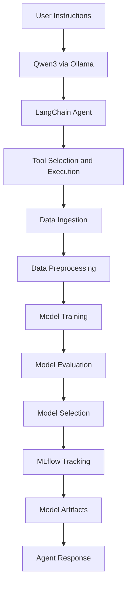

# Autonomous MLOps Agent


**AI-Powered Automation for End-to-End Machine Learning and MLOps Workflows**

*Part of the Chandan-AIOps Modular MLOps Initiative*

---

## 1. Project Overview

The **Autonomous MLOps Agent** is an AI-powered application designed to automate key stages of the Machine Learning lifecycle using **Qwen3, LangChain, Ollama, and Python**.

The primary objective is to develop an intelligent agent that executes end-to-end MLOps workflows through natural-language instructions, reducing the need for manually running individual machine learning scripts.

By integrating a locally hosted Large Language Model (LLM) with LangChain agent orchestration and tool calling, the system interprets user instructions, selects appropriate tools, and executes predefined machine learning operations.

Users can interact with the agent to perform data inspection, preprocessing, model training, evaluation, model selection, experiment tracking, and artifact management.

## 2. Project Objectives

The project focuses on the following capabilities:

1. **Automated Data Ingestion:** Load datasets, validate data availability, and perform initial data inspection.
2. **Automated Data Preprocessing:** Handle missing values, encode categorical variables, and prepare datasets for model training.
3. **Automated Model Training:** Train and compare multiple machine learning algorithms.
4. **Automated Model Evaluation:** Evaluate model performance using MAE, RMSE, and R² Score.
5. **Intelligent Model Selection:** Compare evaluation metrics and identify the best-performing model.
6. **Experiment Tracking:** Integrate MLflow to track parameters, metrics, experiment runs, and model artifacts.
7. **AI-Driven Workflow Execution:** Use Qwen3 and LangChain tool calling to execute MLOps operations through natural-language commands.

## 3. Technology Stack

| Technology | Purpose |
|---|---|
| Python | Core programming language |
| Qwen3 1.7B | Locally hosted Large Language Model |
| Ollama | Local LLM runtime and inference |
| LangChain | Agent orchestration and tool calling |
| Scikit-learn | Machine Learning algorithms and evaluation |
| Pandas | Data manipulation and preprocessing |
| NumPy | Numerical computing |
| MLflow | Experiment tracking and model management |

## 4. System Architecture

The agent follows a tool-driven architecture in which the LLM interprets user instructions and delegates operations to predefined Python tools.



## 5. Environment Configuration

### 5.1 Install Ollama

Download and install Ollama:

https://ollama.com/download

Pull the Qwen3 model:

```bash
ollama pull qwen3:1.7b
```

Verify the installed model:

```bash
ollama list
```

### 5.2 Configure Environment Variables

Create a `.env` file in the project root:

```env
BASE_URL=http://localhost:11434/v1
API_KEY=ollama
MODEL=qwen3:1.7b
```

| Variable | Description |
|---|---|
| `BASE_URL` | Ollama OpenAI-compatible API endpoint |
| `API_KEY` | Local client authentication placeholder |
| `MODEL` | Qwen3 model identifier |

Start the Ollama server:

```bash
ollama serve
```

**Note:** The `API_KEY=ollama` value is a local placeholder for OpenAI-compatible client configuration. It is not a cloud API credential.

## 6. Installation and Setup

### Step 1: Clone the Repository

```bash
git clone https://github.com/chandanc5525/Autonomous-MLOps-Agent.git

cd Autonomous-MLOps-Agent
```

### Step 2: Create a Virtual Environment

```bash
uv venv
```

Activate the environment on Windows:

```bash
.venv\Scripts\activate
```

### Step 3: Install Dependencies

```bash
uv add langchain langchain-openai langchain-core python-dotenv pandas numpy scikit-learn mlflow
```

### Step 4: Configure the Environment

Create the `.env` file and add the Ollama configuration described in Section 5.

### Step 5: Run the Application

Run the Python entry-point script configured for the agent:

```bash
python main.py
```

## 7. Expected Outcomes

The project demonstrates how locally hosted LLMs and AI agents can simplify traditional Machine Learning and MLOps workflows.

The expected capabilities include:

- Natural-language interaction with machine learning workflows.
- Automated execution of predefined ML operations.
- Modular and reusable Python components.
- Automated model training and evaluation.
- Performance-based model comparison and selection.
- MLflow-based experiment tracking.
- Local LLM inference without relying on paid cloud LLM APIs.

## 8. Chandan-AIOps: Modular MLOps Initiative

**Chandan-AIOps** is an initiative focused on building modular, reusable, and AI-driven solutions for Machine Learning Operations.

The vision is to simplify the Machine Learning lifecycle by developing independent engineering components that can be integrated into automated workflows.

The Autonomous MLOps Agent contributes an LLM-powered orchestration layer that connects different ML pipeline operations through natural-language interaction.

### Modular MLOps Ecosystem

| Module | Responsibilities |
|---|---|
| Data Engineering | Data ingestion, validation, and preprocessing |
| Model Engineering | Model development, training, and evaluation |
| Experiment Management | Experiment tracking and performance comparison |
| Model Management | Model selection, serialization, and artifact management |
| AI Orchestration | LLM-based automation and agent tool calling |
| Deployment Engineering | Model serving, API integration, and containerization |

> **Chandan-AIOps — Building modular, intelligent, and automated MLOps solutions for the next generation of AI Engineering.**

## 9. Repository Highlights

- Qwen3 and Ollama local LLM integration.
- LangChain-powered agent orchestration.
- Natural-language-driven MLOps operations.
- Modular Python architecture.
- Automated model training and evaluation.
- MLflow experiment tracking.
- Reusable MLOps components.

## 10. Future Enhancements

- Streamlit-based interactive interface.
- Integration of additional ML algorithms and AutoML frameworks.
- Automated hyperparameter optimization.
- Advanced experiment visualization.
- Model versioning and registry integration.
- FastAPI-based model deployment.
- Docker containerization.
- CI/CD pipeline integration.
- Agent memory and multi-agent orchestration.

## 11. Project Information

| Attribute | Details |
|---|---|
| Project Name | Autonomous MLOps Agent |
| Initiative | Chandan-AIOps |
| Programming Language | Python |
| LLM | Qwen3 1.7B |
| LLM Runtime | Ollama |
| Agent Framework | LangChain |
| ML Framework | Scikit-learn |
| Experiment Tracking | MLflow |
| API Integration | Ollama OpenAI-compatible endpoint |

---

**Developed as part of the Chandan-AIOps Initiative**

*Beyond Machine Learning: Building Intelligent and Autonomous MLOps Solutions.*